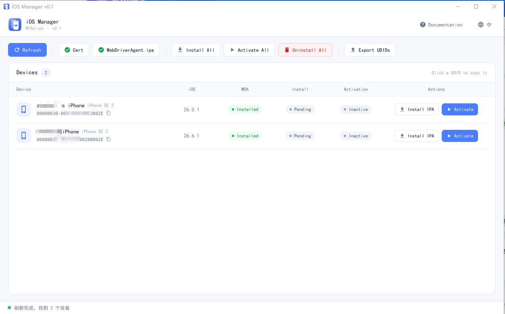

<div align="center">

# iOS Manager

**A free Windows tool for managing iPhones in bulk: batch sign & install IPAs, batch-activate WebDriverAgent, export UDIDs and uninstall apps across every connected device.**

Free · No sign-up · Portable · English / 中文

[**⬇️ Download (official site)**](https://www.wtscript.com/en/download?utm_source=github&utm_medium=readme#manager)
&nbsp;·&nbsp;
[Guide](https://www.wtscript.com/en/docs?utm_source=github&utm_medium=readme#prepare)
&nbsp;·&nbsp;
[中文](README.md)


</div>

<!--
  Screenshot: save the main window as docs/screenshot_zh.png, then remove the first and last lines of this comment.

<p align="center"></p>

-->

---

## Features

| Feature | What it does |
|---|---|
| 📱 **Device list** | Detects iPhones / iPads connected over USB with name, UDID and iOS version |
| 📋 **Copy / export UDIDs** | Click to copy a UDID, or export every connected device's UDID to a `.txt` file |
| ✍️ **Per-device re-signing** | Signs with each device's own `.p12` and `.mobileprovision`, matched automatically by UDID |
| 📦 **Batch IPA install** | Pick an IPA and hit *Install All*: signs and installs on each device in turn with live progress |
| 🔓 **No signing for jailbroken devices** | Devices with AppSync Unified get the original IPA, no certificate needed |
| ⚙️ **Batch activation** | Mounts the Developer Disk Image and starts WebDriverAgent; iOS 17+ supported |
| 🗑️ **Batch uninstall** | Remove one app (by Bundle ID) from every connected device at once |
| 💾 **Remembers settings** | Certificate folder, IPA location and signing mode are saved between runs |

## Download

> 👉 **[Get the latest version from the official site](https://www.wtscript.com/en/download?utm_source=github&utm_medium=readme#manager)** (release notes and SHA-256 checksums included)

The download page also hosts the matching **WebDriverAgent** and **CloudClick iOS** app packages.

## Quick start

1. Unzip the package and run `ios-manager.exe`.
2. Connect the iPhone over USB, tap **Trust** on the phone, then click **Refresh**.
3. Open **Cert** to choose your certificate folder (or the jailbroken mode), then **Select IPA** → **Install All**.

Certificate folder layout — one folder per device, named by its UDID:

```
certificates/
├── 00008110-001A2B3C4D5E6F7A/     ← device UDID
│   ├── xxx.p12                     ← certificate
│   ├── xxx.mobileprovision         ← provisioning profile
│   └── password.txt                ← certificate password (any .txt name)
└── 00008030-000B1C2D3E4F5A6B/
    └── …
```

Full guide (activation, Developer Mode, troubleshooting): **[wtscript.com/en/docs](https://www.wtscript.com/en/docs?utm_source=github&utm_medium=readme#prepare)**

## Requirements

- Windows 10 / 11 (64-bit)
- iOS 13 or later; on iOS 16+ turn on Developer Mode on the phone
- A USB cable that supports data transfer

## iOS device farm platform

iOS Manager is the companion tool of **[CloudClick iOS](https://www.wtscript.com/en?utm_source=github&utm_medium=readme)** — a browser-based platform for controlling fleets of real iPhones: no-code script recording, image / color matching and OCR, P2P live screen casting, and one-click batch runs across device groups.

Custom development (iOS device farms, automation scripts): Telegram [@WTScript](https://t.me/WTScript) · QQ 3252528962

---

<sub>Keywords: iOS batch IPA install · iPhone bulk signing · IPA resign tool · export UDID · WebDriverAgent activation · iOS device farm · iOS automation · zsign GUI · Windows iOS manager</sub>

<sub>© 2026 WTScript. All rights reserved.</sub>
